# Pokédex — React + Vite

Pokédex dos 151 Pokémon de Kanto feita em **React + Vite** para a Atividade 03 de Desenvolvimento e Integração de Aplicações Web.

O site tem **dois visuais**, que você troca por um botão no cabeçalho:

- **Clássico**: inspirado no Game Boy Advance (FireRed/LeafGreen), com fonte pixelada, caixas de texto com moldura dupla e sprites em pixel art.
- **Moderno**: inspirado nos jogos de Switch (Scarlet/Violet, Sword/Shield), com fundo escuro, vidro fosco e renders 3D.

Ao abrir o site, toca uma **animação de captura** igual à dos jogos: um Pokémon selvagem aparece, a Poké Bola é arremessada, balança três vezes e... *Gotcha!*

| Clássico | Moderno |
| --- | --- |
| 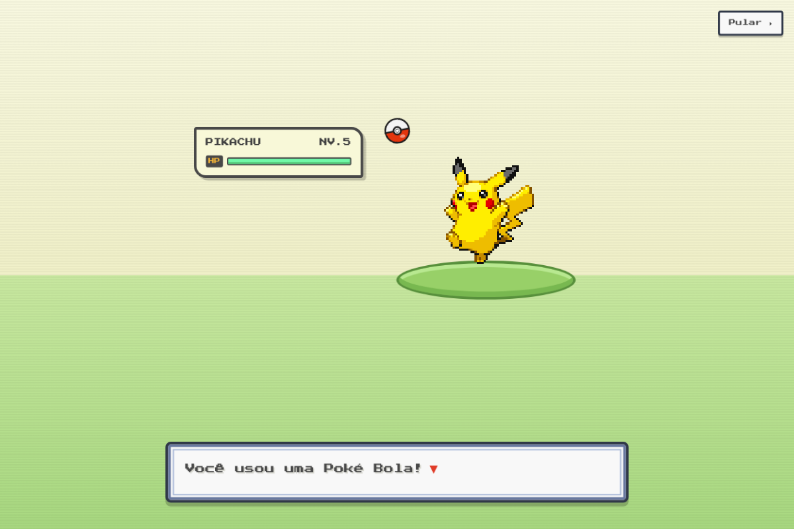 | 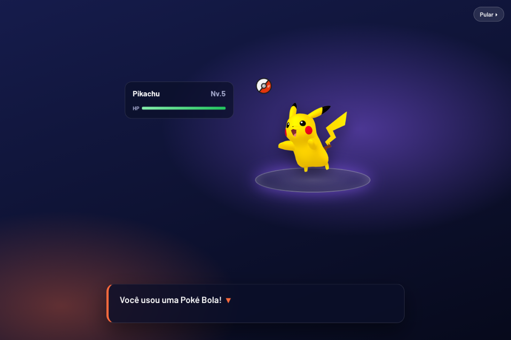 |
| 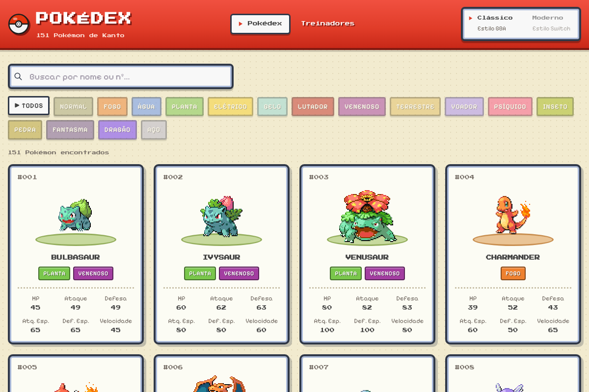 | 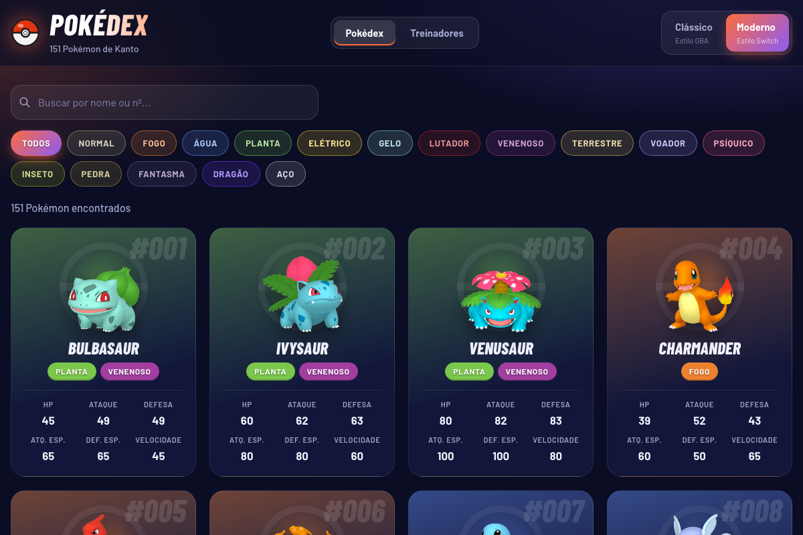 |
| 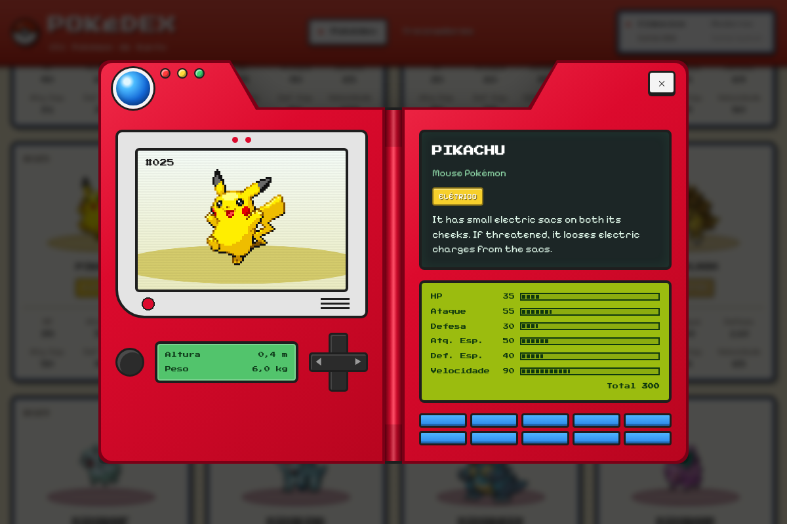 | 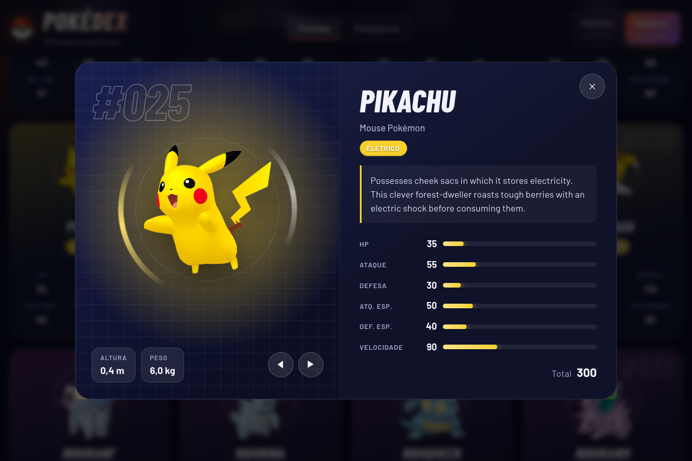 |
| 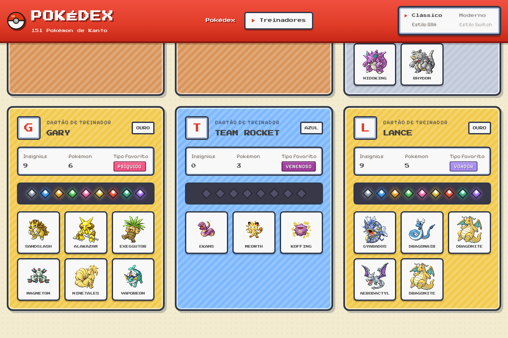 | 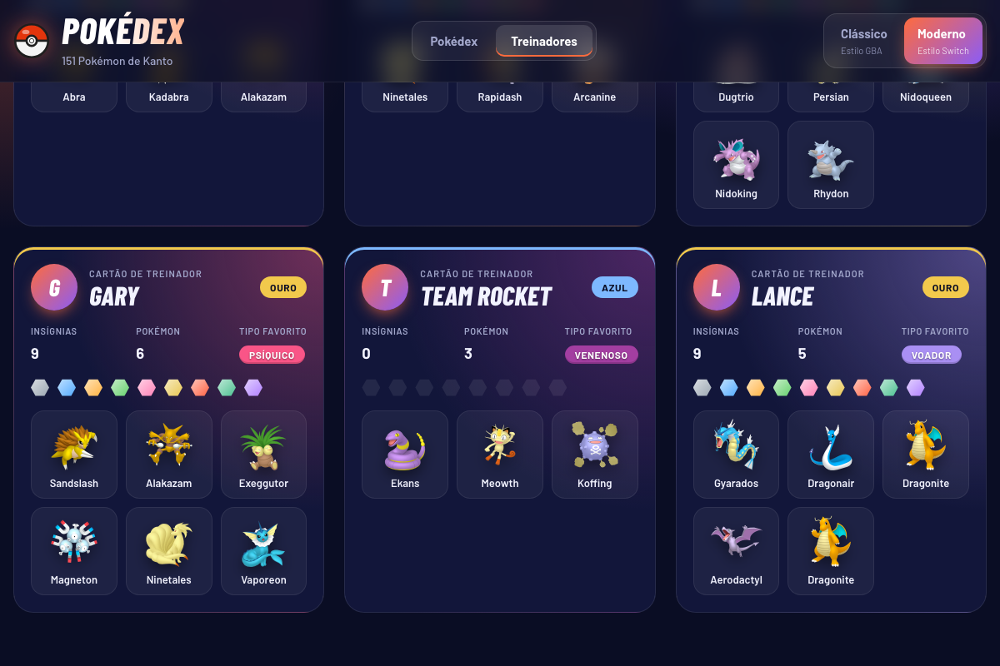 |

<details>
<summary>Mais prints: filtros, busca sem resultado e celular</summary>

| Clássico | Moderno |
| --- | --- |
| 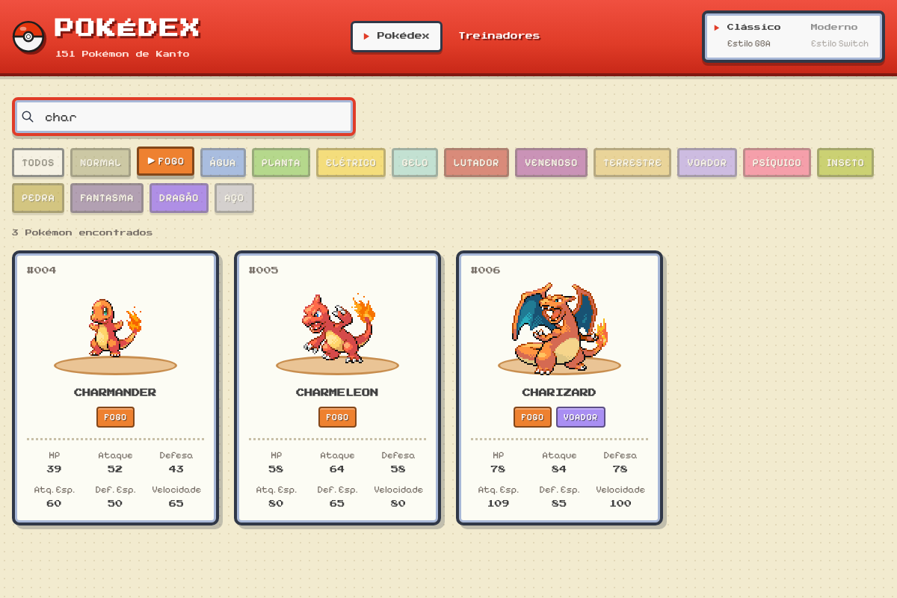 | 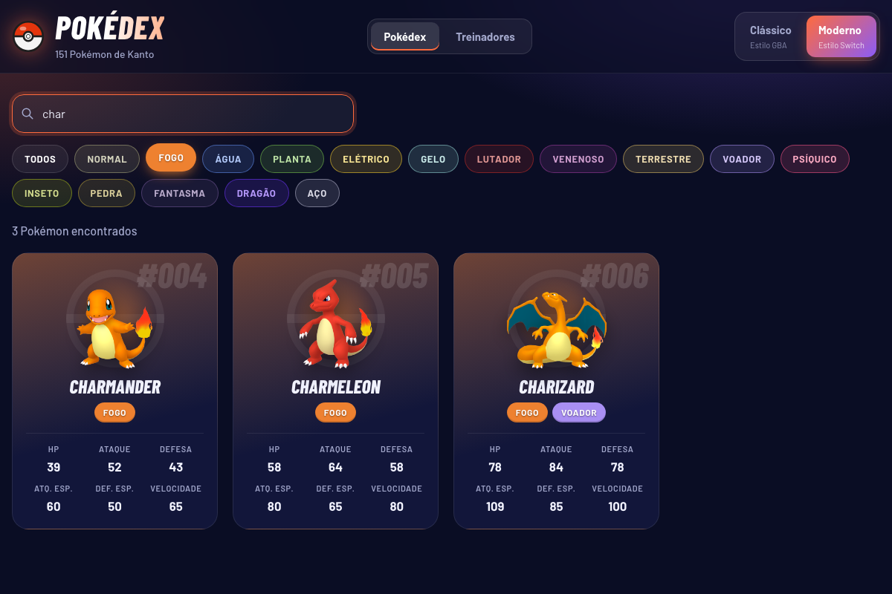 |
| 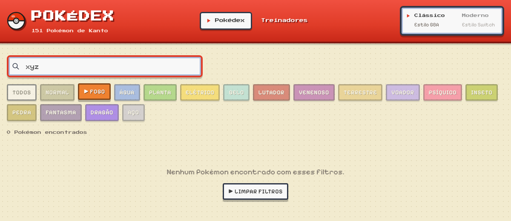 | 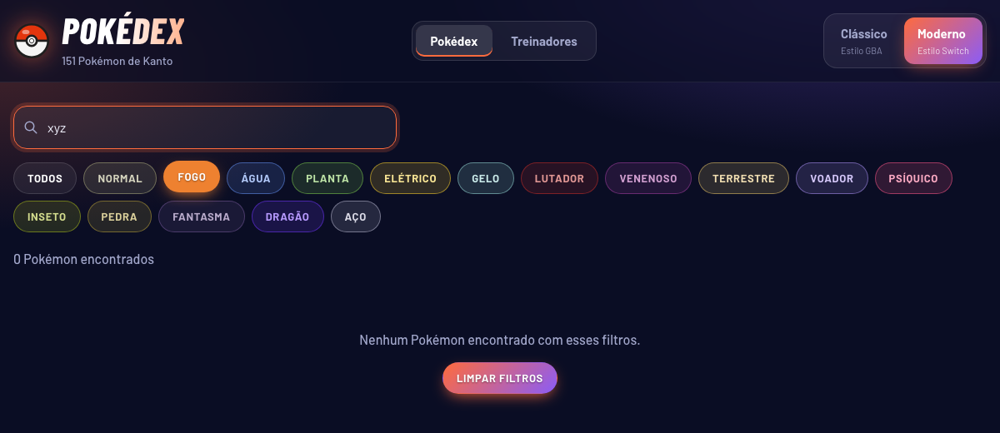 |
| 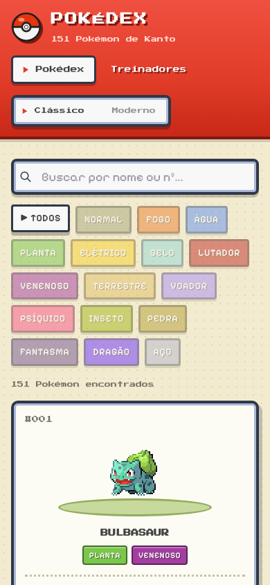 | 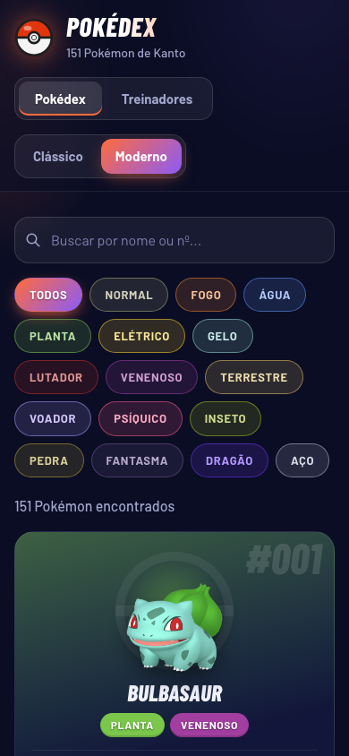 |
| 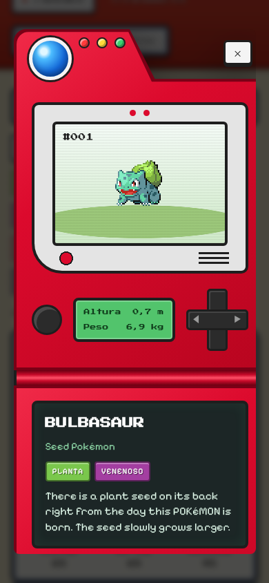 | 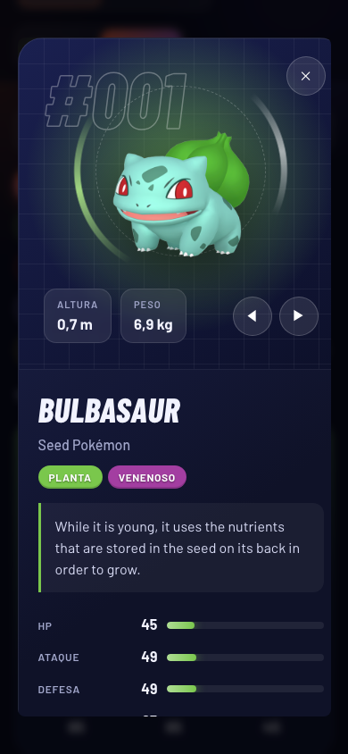 |

</details>

---

## Como rodar

Pré-requisito: **Node.js 20.19+ ou 22.12+** (exigência do Vite 8).

```bash
cd pokedex
npm install
npm run dev
```

Depois, abra **http://localhost:5173** no navegador.

Outros comandos:

| Comando | O que faz |
| --- | --- |
| `npm run build` | Gera a versão de produção em `pokedex/dist/` |
| `npm run preview` | Serve a versão de produção localmente |
| `npm run lint` | Verifica o código com o oxlint |

---

## Funcionalidades

### Requisitos da atividade

- **Tela da Pokédex**: um card para cada Pokémon, com ID, nome, tipos e os seis atributos (HP, Ataque, Defesa, Ataque Especial, Defesa Especial e Velocidade).
- **Busca** por nome ou número, filtrando enquanto o usuário digita. Aceita `char`, `25` ou `#025`.
- **Filtro por tipo** com botões nas cores de cada tipo. Ele só lista os tipos que algum Pokémon realmente tem e funciona junto com a busca.
- **Mensagem de "nenhum encontrado"**, com um botão para limpar os filtros.
- **Detalhes** em um modal desenhado como uma Pokédex:
  - **Clássico**: o aparelho vermelho de Kanto, com lente azul, tela, D-pad, telinha verde e barras de atributos em estilo Game Boy.
  - **Moderno**: painel holográfico com barras animadas e o total dos atributos.
  - As setas da tela ou do teclado (◀ ▶) passam para o Pokémon anterior ou o próximo, e o **Esc** fecha o modal.
- **Treinadores**: uma aba separada com um "Cartão de Treinador" para cada um, mostrando:
  - as insígnias
  - a quantidade de Pokémon
  - o **tipo favorito**, calculado a partir do time
  - o time, em que clicar num Pokémon abre a Pokédex dele.

  A cor do cartão muda conforme o número de insígnias (Azul → Verde → Bronze → Prata → Ouro), como no Trainer Card de FireRed.
- **Layout responsivo**, testado do celular (390px) ao desktop.

### Desafios opcionais feitos

- **Integração com API externa**: a Pokédex busca na [PokéAPI](https://pokeapi.co/) a descrição, a categoria, a altura e o peso, que não estão no JSON.
- **Tema escuro**: o visual moderno.
- **Animações**: a intro de captura, o texto que aparece letra por letra, os sprites "pulando" e as barras de atributos.
- **Responsividade avançada**: no celular, a Pokédex clássica "dobra" na vertical.
- **Acessibilidade**:
  - navegação pelo teclado
  - foco visível
  - a intro e as animações em loop são desligadas para quem ativou "reduzir movimento" no sistema.

---

## Onde estão os dados

Os dados principais (Pokémon, tipos, atributos e treinadores) estão em:

```
pokedex/src/data/pokedex-data.json
```

O arquivo é importado direto no `App.jsx`. Os treinadores guardam só os IDs dos Pokémon (`pokemonIds`), e o App junta esses IDs com os dados completos de cada Pokémon.

---

## Estrutura do projeto

```
pokedex/
├── index.html                 # HTML base + fontes do Google Fonts
├── public/favicon.svg         # Pokébola
└── src/
    ├── main.jsx               # Ponto de entrada (MantineProvider + App)
    ├── App.jsx                # Estado principal: busca, filtro, tema, aba e Pokémon aberto
    ├── App.css                # Estrutura/layout da página
    ├── index.css              # Estilos globais
    ├── data/
    │   └── pokedex-data.json  # Dados da atividade
    ├── components/
    │   ├── IntroAnimation     # Animação de captura da abertura (.jsx + .css)
    │   ├── Pokeball.jsx       # Pokébola em SVG (logo e intro)
    │   ├── ThemeToggle.jsx    # Botão Clássico / Moderno
    │   ├── ViewTabs.jsx       # Abas Pokédex / Treinadores
    │   ├── SearchBar.jsx      # Campo de busca (Mantine)
    │   ├── TypeFilter.jsx     # Botões de filtro por tipo
    │   ├── TypeBadge.jsx      # Etiqueta de tipo (reaproveitada em vários lugares)
    │   ├── PokemonList.jsx    # Grade de cards
    │   ├── PokemonCard.jsx    # Card de um Pokémon
    │   ├── PokemonDetails     # Modal com a Pokédex (.jsx + .css)
    │   ├── TrainerList.jsx    # Lista de treinadores
    │   └── TrainerCard.jsx    # Cartão de Treinador
    ├── services/
    │   └── pokeapi.js         # Busca na PokéAPI (com cache)
    ├── themes/
    │   ├── classic.css        # Visual clássico (GBA)
    │   └── modern.css         # Visual moderno (Switch)
    └── utils/
        ├── pokemon.js         # Sprites, tipos (nome em PT e cor), atributos
        ├── trainers.js        # Insígnias, nível do cartão, tipo favorito
        └── storage.js         # localStorage seguro (salva o visual escolhido)
```

### Conceitos de React usados

| Conceito | Onde |
| --- | --- |
| Componentes funcionais e props | Todos os componentes. Os dados descem do `App` por props. |
| `useState` | Busca, tipo selecionado, tema, aba, Pokémon aberto, etapas da intro |
| Estado derivado | A lista filtrada é calculada a cada render, sem `useState` próprio. O tipo favorito de cada treinador também. |
| `useEffect` | Busca na PokéAPI, atalhos de teclado, timers da intro |
| `useLayoutEffect` | Aplica o tema no `<html>` antes de pintar a tela |
| `useCallback` | Função estável para encerrar a intro |
| `map()` em listas | Cards, filtros, insígnias, times, atributos |
| Eventos | `onClick`, `onChange`, `keydown` |

---

## Fontes externas

| Recurso | Uso |
| --- | --- |
| [PokéAPI — sprites](https://github.com/PokeAPI/sprites) | Imagens dos Pokémon: pixel art de FireRed/LeafGreen (visual clássico) e renders do Pokémon HOME (visual moderno) |
| [PokéAPI — API REST](https://pokeapi.co/) | Descrição da Pokédex, categoria, altura e peso, mostrados no modal. A PokéAPI não tem textos em português, então as descrições aparecem em inglês. |
| [Google Fonts](https://fonts.google.com/) | Press Start 2P e Pixelify Sans (clássico); Barlow e Barlow Condensed (moderno) |
| [Mantine](https://mantine.dev/) | Campo de busca (`TextInput`) e modal (`Modal`) |
| [Tabler Icons](https://tabler.io/icons) | Ícone de lupa da busca |

A animação de abertura e a Pokédex foram feitas do zero em CSS/SVG, inspiradas nos jogos.

> Pokémon e todos os nomes relacionados são marcas registradas da Nintendo, Game Freak e The Pokémon Company. Este é um projeto acadêmico, sem fins comerciais.

---

## Integrantes

- _Nome do integrante 1_
- _Nome do integrante 2_
