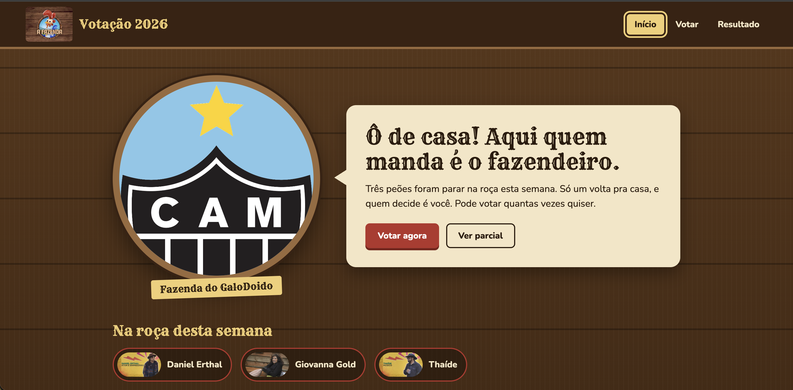

# ⚛️ React


Repositório onde eu guardo meus projetos em **React**, a maioria feita para a disciplina de **Desenvolvimento e Integração de Aplicações Web (DIAW)**.

Cada pasta é um projeto independente, com o próprio `package.json`, as próprias dependências e um README explicando como ele funciona.

---

## 📂 Projetos

### 🐓 Votação A Fazenda 2026



Votação de eliminação de **A Fazenda 2026**: o usuário vê quem está na roça, vota em quem deve sair e acompanha a parcial com o total e o percentual de votos. Os votos ficam salvos no `localStorage`.

- **Contexto:** Avaliação 2 de DIAW ([enunciado](Avaliacao2-DIAW/AV2_DIAW.pdf))
- **Stack:** React, Vite, React Router
- **Pasta:** [`Avaliacao2-DIAW/`](Avaliacao2-DIAW/) · [README do projeto](Avaliacao2-DIAW/README.md)

### 🔴 Pokédex


Pokédex dos 151 Pokémon de Kanto com **dois visuais** (clássico, no estilo Game Boy Advance, e moderno, no estilo Switch), busca, filtro por tipo, cartões de treinador e animação de captura na abertura. Usa a PokéAPI para buscar descrição, altura e peso.

- **Contexto:** Atividade 03 de DIAW
- **Stack:** React, Vite, Mantine, PokéAPI
- **Pasta:** [`PokeDex/`](PokeDex/) · [README do projeto](PokeDex/README.md)

---

## 🚀 Como rodar um projeto

Pré-requisito: **Node.js 20.19+ ou 22.12+** (exigência do Vite 8).

```bash
git clone https://github.com/leonardoMartins-Dev/React.git
cd React/<pasta-do-app>
npm install
npm run dev
```

Depois, abra **http://localhost:5173** no navegador.

| Projeto | Pasta do app |
| --- | --- |
| Votação A Fazenda 2026 | `Avaliacao2-DIAW/Fazendeiro` |
| Pokédex | `PokeDex/pokedex` |

Todos os projetos têm os mesmos scripts:

| Comando | O que faz |
| --- | --- |
| `npm run dev` | Sobe o servidor de desenvolvimento |
| `npm run build` | Gera a versão de produção em `dist/` |
| `npm run preview` | Serve a versão de produção localmente |
| `npm run lint` | Verifica o código com o oxlint |

---

## 🗂️ Estrutura do repositório

```
React/
├── Avaliacao2-DIAW/
│   ├── AV2_DIAW.pdf      # Enunciado da avaliação
│   ├── README.md         # Documentação do projeto
│   └── Fazendeiro/       # App React (Vite)
│
├── PokeDex/
│   ├── README.md         # Documentação do projeto
│   ├── imgs/             # Prints usados no README
│   └── pokedex/          # App React (Vite)
│
└── README.md             # Este arquivo
```

O padrão é: **uma pasta por projeto**, com o README e os prints na raiz dela e o app React numa subpasta.

---

## ➕ Adicionando um novo projeto

1. Crie uma pasta na raiz do repositório com o nome do projeto:

   ```bash
   mkdir NomeDoProjeto
   cd NomeDoProjeto
   ```

2. Crie o app com o Vite dentro dela:

   ```bash
   npm create vite@latest nome-do-app -- --template react
   cd nome-do-app
   npm install
   ```

3. Escreva um `README.md` na pasta do projeto, com prints e instruções para rodar.
4. Adicione o projeto na seção [Projetos](#-projetos) deste README.

> ⚠️ Se o projeto veio de outro repositório, apague a pasta `.git` de dentro dele antes de fazer o commit. Senão o Git trata a pasta como **submódulo** e o código não aparece no GitHub.
>
> ```bash
> rm -rf NomeDoProjeto/nome-do-app/.git
> ```

---

## 👤 Autor

**Leonardo Martins** · [@leonardoMartins-Dev](https://github.com/leonardoMartins-Dev)
